<p align="center">
  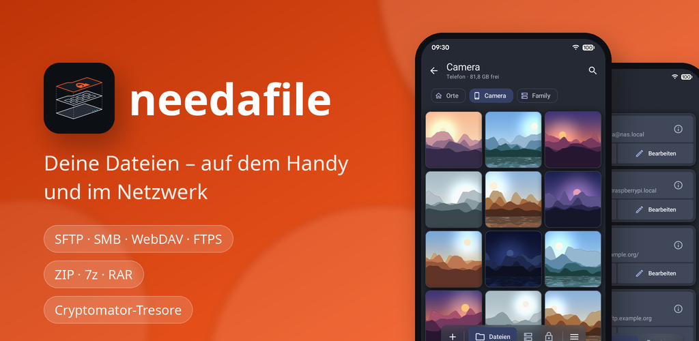
</p>

# needafile

**Dateimanager für Handy und Netzwerk: SFTP, SMB, WebDAV, FTPS und Archive**

needafile ist ein Dateimanager für Android 12 und neuer – für die Dateien auf dem Handy und auf den Servern im eigenen Netzwerk, im modernen Material-3-Expressive-Stil.

[F-Droid-Repo](https://apps.needanapp.de) · [Download (APK)](https://github.com/needanapp-de/needafile/releases/latest) ·
Android 12 und neuer · Lizenz [GPL-3.0](LICENSE) ·
Herausgeber needanapp.de

**Deutsch** · [English](#english)

## Warum needafile

Ich baue Apps, die ich selbst brauche. Meinen Launcher zum Beispiel habe ich gebaut, weil meine Favoriten Action
Launcher, Nova Launcher und zuletzt Octopi Launcher für mich nicht mehr nutzbar waren und die Alternativen nicht boten,
was ich wollte. Genauso ist needafile entstanden: ein Dateimanager, individuell gebaut für das, was ich brauche, ohne den
Anspruch, komplett zu sein. So entstehen eigentlich alle meine Apps, manche selbst entwickelt, manche aus bestehenden
umgebaut.

## Installieren

Über das F-Droid-Repo von needanapp.de, mit automatischen Updates: in F-Droid (oder einer anderen F-Droid-App) unter
„Paketquellen“ diese Adresse hinzufügen oder [apps.needanapp.de](https://apps.needanapp.de) auf dem Handy öffnen und dort
„Paketquelle hinzufügen“ antippen.

```text
https://apps.needanapp.de/repo?fingerprint=35453386642F44485E4D556E1F631A1F2AD22CA3B02FB2C72B0A9807E5B30488
```

Oder die APK unter [Releases](https://github.com/needanapp-de/needafile/releases/latest) herunterladen und öffnen. Beide
sind mit demselben Schlüssel signiert, Updates gehen also in beide Richtungen.

Fingerabdruck (SHA-256) des Signaturzertifikats, zum Prüfen der APK:
`C6:0E:A3:B5:6D:A7:0E:60:EF:F5:CB:96:DD:8D:C1:9A:41:86:0A:3E:D4:B2:9A:EB:2A:29:9F:83:3A:63:51:D9`

## Bilder

<table>
  <tr>
    <td align="center" width="25%">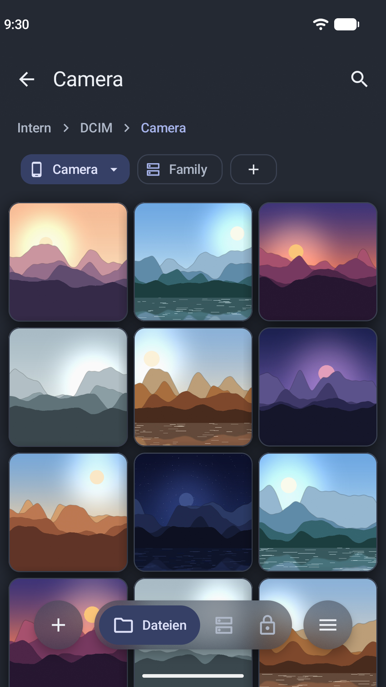<br><sub>Fotos als Galerie, Tabs für mehrere Orte</sub></td>
    <td align="center" width="25%">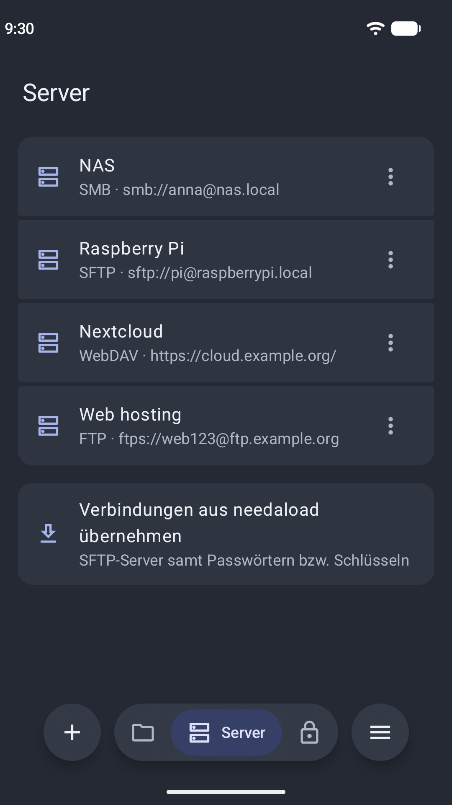<br><sub>Gespeicherte Server: SMB, SFTP, WebDAV, FTPS</sub></td>
    <td align="center" width="25%">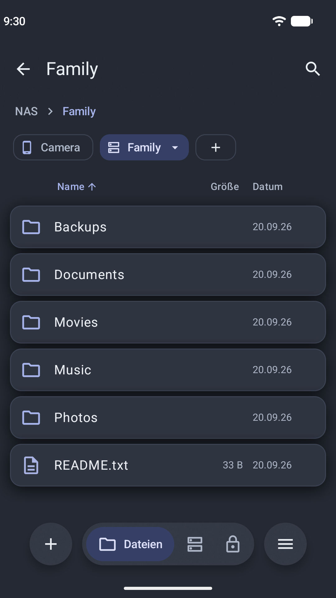<br><sub>NAS im eigenen Tab, Menü am rechten Knopf</sub></td>
    <td align="center" width="25%">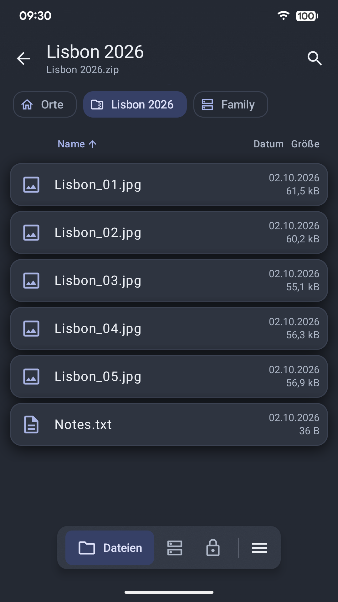<br><sub>ZIP-Archiv wie einen Ordner öffnen</sub></td>
  </tr>
  <tr>
    <td align="center" width="25%"><br><sub>Bildanzeige mit schwebender Karte</sub></td>
    <td align="center" width="25%">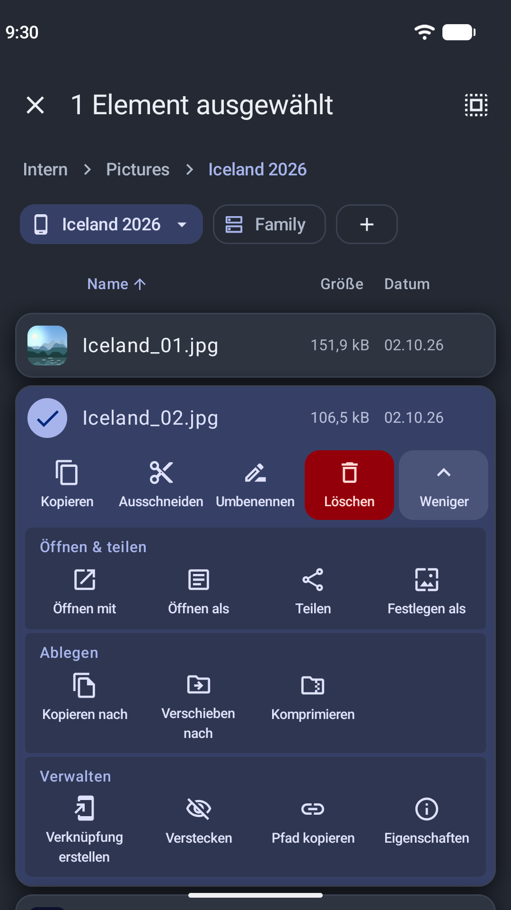<br><sub>Das Plus macht die Pille zur Neu-Leiste</sub></td>
    <td align="center" width="25%">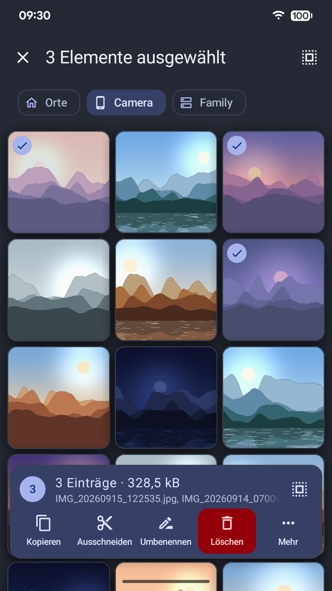<br><sub>Mehrere Dateien: eine Karte mit Anzahl und Größe</sub></td>
    <td align="center" width="25%">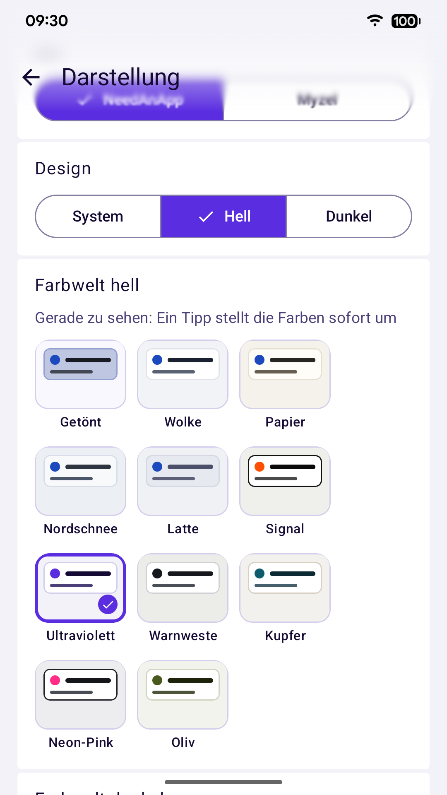<br><sub>Farbwelten für hell und dunkel</sub></td>
  </tr>
</table>

## Funktionen

### Handy

- Interner Speicher, SD-Karten und USB-Sticks, optional Root
- Tabs für mehrere Orte, Kopieren und Verschieben im Hintergrund mit Fortschritt und Abbrechen
- Ansicht als Liste, Details, Raster oder Galerie; Zoomen mit zwei Fingern; Gruppieren nach Datum, Typ, Größe oder Name
- Lang drücken öffnet eine Karte mit allen Aktionen; mehrere markierte Einträge teilen sich eine Karte
- Suche, Verknüpfungen auf dem Startbildschirm, Texteditor
- Prüfsummen (MD5, SHA-1, SHA-256, SHA-512) mit Vergleich gegen die Zwischenablage

### Netzwerk

- SFTP (mit Prüfung des Server-Schlüssels), SMB, WebDAV und FTPS; unverschlüsseltes FTP nur nach Rückfrage pro Server
- Selbst signierte Zertifikate erst nach Bestätigung des Fingerabdrucks, Warnung bei Änderung
- Passwörter verschlüsselt im Android Keystore
- Findet Server im Netzwerk (Bonjour/mDNS, WS-Discovery)
- Übertragungen sind pausierbar; nach einem Verbindungsabbruch wartet die App bis zu einer Stunde und macht an der Abbruchstelle weiter

### Archive

- ZIP (mit AES-Verschlüsselung, aufgeteilt) und 7z (auch mit verschlüsselten Dateinamen) erstellen
- RAR 4/5, 7z, tar, gz, bz2, xz, ISO, CAB und viele weitere entpacken
- Archive wie Ordner öffnen, auch auf Servern

### Tresore

- Cryptomator-Tresore anlegen und öffnen, auf dem Handy und auf Servern; Dateinamen und Inhalte bleiben verschlüsselt
- Entsperren per Passwort oder Fingerabdruck; Wiederherstellungsschlüssel, Passwort ändern
- Sperren sich im Hintergrund oder beim Ausschalten des Bildschirms von selbst; eine Benachrichtigung zählt herunter und sperrt sie auf Tipp

### Anzeigen

- Bilder (JPEG, PNG, WebP, GIF, SVG, HEIC, AVIF, JPEG XL …) mit einfachem Editor
- Dokumente: PDF, Word, Excel, OpenDocument, Markdown, CSV und HTML

### Außerdem

- Schutz per PIN, Muster oder Fingerabdruck
- Einstellungen und Server in einer passwortgeschützten Datei sichern
- Hell, dunkel und reines Schwarz, Farbwelten wie Wolke, Nordnacht, Signal oder Ultraviolett, Material You oder eigene Akzentfarbe
- Deutsch und Englisch

needafile ist freie Software (GPL-3.0). Netzwerkzugriff braucht die App nur für die Server-Verbindungen.

<details>
<summary><b>Alle Funktionen im Detail</b></summary>

- Interner Speicher, SD-Karte, USB und (optional) Root
- Server-Verbindungen: SFTP (mit Prüfung des Server-Schlüssels), SMB, WebDAV und FTPS (explizit oder implizit;
  selbst signierte Zertifikate nach Bestätigung des Fingerabdrucks, Warnung bei Änderung), unverschlüsseltes FTP
  nur nach Rückfrage pro Server; Zugangsdaten verschlüsselt im Android Keystore
- Server im Netzwerk finden: Bonjour/mDNS (SMB, SFTP/SSH, WebDAV, FTP) und Windows-Rechner bzw. NAS per WS-Discovery
- Einstellungen sichern und wiederherstellen: Darstellung, Einstellungen und Server (mit Passwörtern,
  bestätigten Schlüsseln und Zertifikaten) in einer per Passwort verschlüsselten Datei (Argon2id, AES-256-GCM); beim
  Import wählbar, welche Bereiche ersetzt werden
- Tabs für mehrere Orte; Kopieren und Verschieben im Hintergrund mit Fortschritt und Abbrechen, auf dem Gerät wie
  zwischen Gerät und Server; Server-Übertragungen sind pausierbar, nach einem Verbindungsabbruch wartet die App bis
  zu einer Stunde und macht an der Abbruchstelle weiter
- Packen und Entpacken: ZIP (Kompressionsstufe, AES-128/256, Aufteilen in Teile), 7z (Kompressionsstufe,
  Solid-Archiv, auch mit verschlüsselten Dateinamen); entpacken außerdem RAR 4/5 (auch mehrteilig und
  verschlüsselt), mehrteiliges 7z, tar(.gz/.bz2/.xz), gz, bz2, xz, Z, lzma, ISO, CAB, ARJ, LZH, WIM, CPIO, RPM,
  DEB, CHM und XAR
- Archive wie Ordner öffnen (schreibgeschützt, auch auf Servern und verschachtelt): Dateien direkt ansehen,
  einzelne Dateien oder Ordner entpacken, kopieren oder teilen
- Ansichten: Liste (kompakt, normal, groß), Details mit Spalten (Tippen auf eine Spalte sortiert), Raster und
  Galerie; Zoomen mit zwei Fingern; Gruppieren nach Datum, Typ, Größe oder Anfangsbuchstabe mit einklappbaren
  Überschriften; Ordner mit überwiegend Bildern und Videos öffnen sich als Galerie; allgemein oder pro Ordner
- Suche, Verknüpfungen auf dem Startbildschirm, Texteditor
- Prüfsummen (MD5, SHA-1, SHA-256, SHA-512) in den Eigenschaften, mit Vergleich gegen die Zwischenablage
- Bildanzeige (JPEG, PNG, WebP, GIF, SVG, HEIC, AVIF, JPEG XL u. a.) mit Zoom, Wischen durch den Ordner und
  Bilddetails (EXIF); Bildeditor zum Zuschneiden, Drehen, Spiegeln, Skalieren und Zeichnen –
  speichert standardmäßig als Kopie
- Dokumentanzeige: PDF (auch mit Passwort), Word (DOCX), Excel (XLSX), OpenDocument (ODS, ODT), Markdown,
  CSV und HTML, mit Suche und Drucken
- Bild- und Dokumentanzeige auch für andere Apps („Öffnen mit“)
- Cryptomator-Tresore (Format 8 und 7) anlegen und öffnen, lokal und auf allen Servern; Vorschaubilder nur im
  internen Cache, Bilder im Tresor durchwischen; Entsperren per Passwort oder Fingerabdruck,
  Wiederherstellungsschlüssel, Passwort ändern; automatische Sperre nach wählbarer Zeit im Hintergrund oder beim
  Ausschalten des Bildschirms (laufende Übertragungen werden vorher fertig), Benachrichtigung mit Countdown und
  Sperren-Taste
- Schutz per PIN, Muster oder Fingerabdruck
- Datei auswählen und „Speichern unter“ für andere Apps
- Darstellung: hell/dunkel/reines Schwarz, Farbwelten (Wolke, Papier, Nordschnee, Latte, Graphit, Nordnacht,
  Mitternacht, Gedimmt sowie Signal, Ultraviolett, Warnweste, Kupfer, Neon-Pink und Oliv mit eigener Akzentfarbe),
  Material You oder eigene Akzentfarbe, Paletten-Stile,
  progressiver Blur hinter Kopfzeile und Navigation, UI-Skalierung, eigene Schrift; App-Symbol in zwölf Farben
- Deutsch und Englisch

</details>

## Dank

- [7-Zip-JBinding](https://github.com/omicronapps/7-Zip-JBinding-4Android) und p7zip (LGPL-2.1) – 7z, RAR und weitere Archive
- Alle weiteren Bibliotheken mit Lizenzen stehen in der App unter Einstellungen → Über

## Lizenz

GPL-3.0, siehe [LICENSE](LICENSE).

---

<a id="english"></a>

<p align="center">
  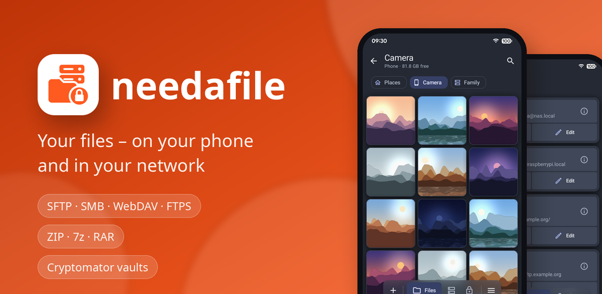
</p>

# needafile (English)

**File manager for the phone and the network: SFTP, SMB, WebDAV, FTPS and archives**

needafile is a file manager for Android 12 and newer – for the files on your phone and on the servers in your own
network, in the modern Material 3 Expressive look.

[F-Droid repo](https://apps.needanapp.de) · [Download (APK)](https://github.com/needanapp-de/needafile/releases/latest) ·
Android 12 and newer · License [GPL-3.0](LICENSE) ·
Publisher needanapp.de

[Deutsch](#needafile) · **English**

## Why needafile

I build the apps I need myself. My launcher, for example, came about because my favourites – Action Launcher, Nova
Launcher and most recently Octopi Launcher – no longer worked for me, and the alternatives didn't offer what I wanted.
needafile came about the same way: a file manager built for what I need, without claiming to be complete. That's how
pretty much all my apps come about: some developed from scratch, some rebuilt from existing ones.

## Install

From the F-Droid repo of needanapp.de, with automatic updates: in F-Droid (or another F-Droid app) add this address
under “Repositories”, or open [apps.needanapp.de](https://apps.needanapp.de) on the phone and tap the button to add the
repository there.

```text
https://apps.needanapp.de/repo?fingerprint=35453386642F44485E4D556E1F631A1F2AD22CA3B02FB2C72B0A9807E5B30488
```

Or download the APK from [Releases](https://github.com/needanapp-de/needafile/releases/latest) and open it. Both are signed
with the same key, so updates work in both directions.

Fingerprint (SHA-256) of the signing certificate, to check the APK:
`C6:0E:A3:B5:6D:A7:0E:60:EF:F5:CB:96:DD:8D:C1:9A:41:86:0A:3E:D4:B2:9A:EB:2A:29:9F:83:3A:63:51:D9`

## Pictures

<table>
  <tr>
    <td align="center" width="25%">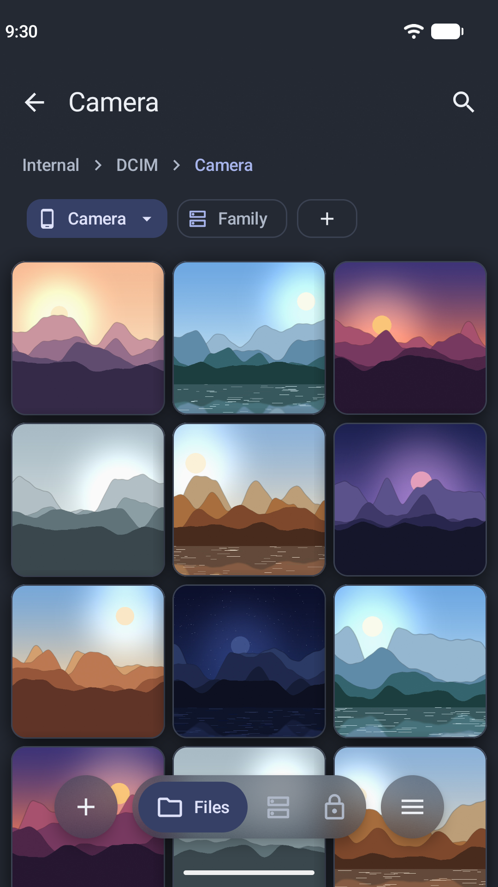<br><sub>Photos as a gallery, tabs for several places</sub></td>
    <td align="center" width="25%">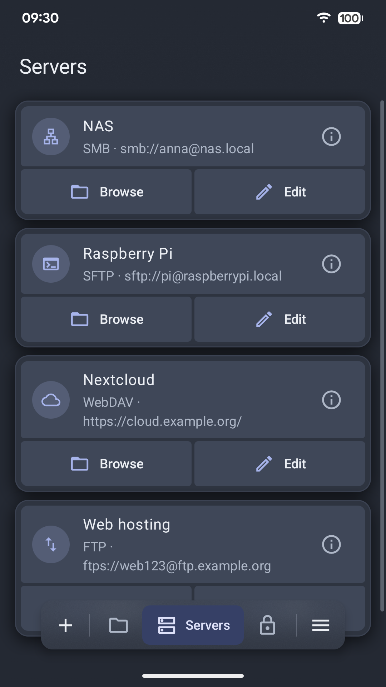<br><sub>Saved servers: SMB, SFTP, WebDAV, FTPS</sub></td>
    <td align="center" width="25%">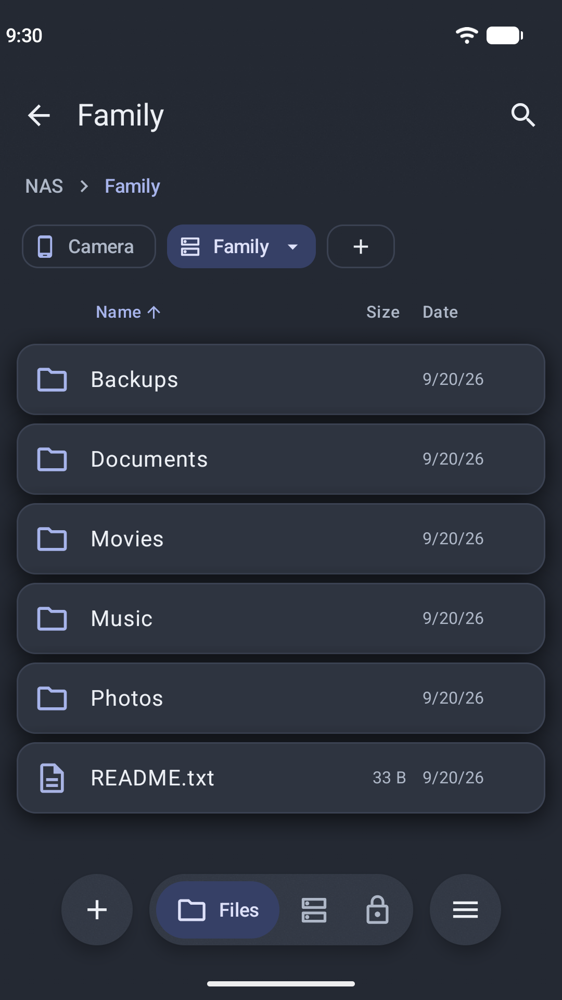<br><sub>The NAS in a tab of its own, menu on the right button</sub></td>
    <td align="center" width="25%">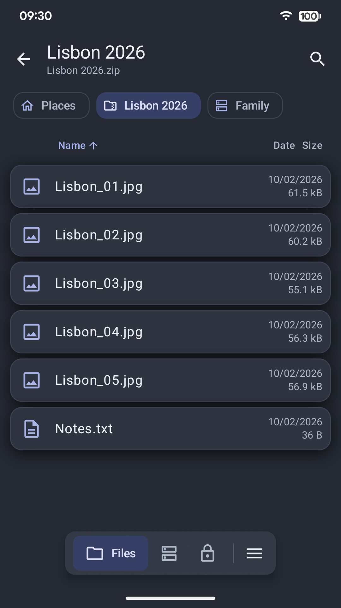<br><sub>Open a ZIP archive like a folder</sub></td>
  </tr>
  <tr>
    <td align="center" width="25%">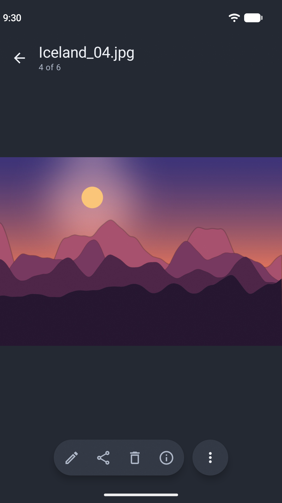<br><sub>Picture viewer with a floating card</sub></td>
    <td align="center" width="25%">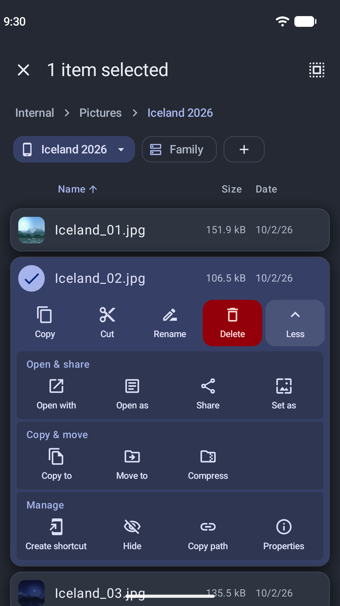<br><sub>The plus turns the pill into a bar for new items</sub></td>
    <td align="center" width="25%">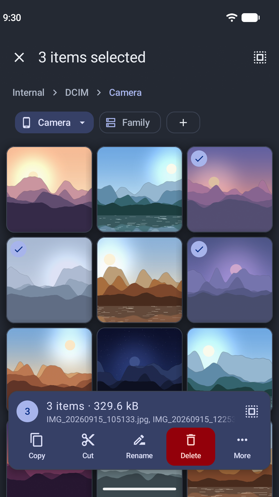<br><sub>Several files: one card with count and size</sub></td>
    <td align="center" width="25%">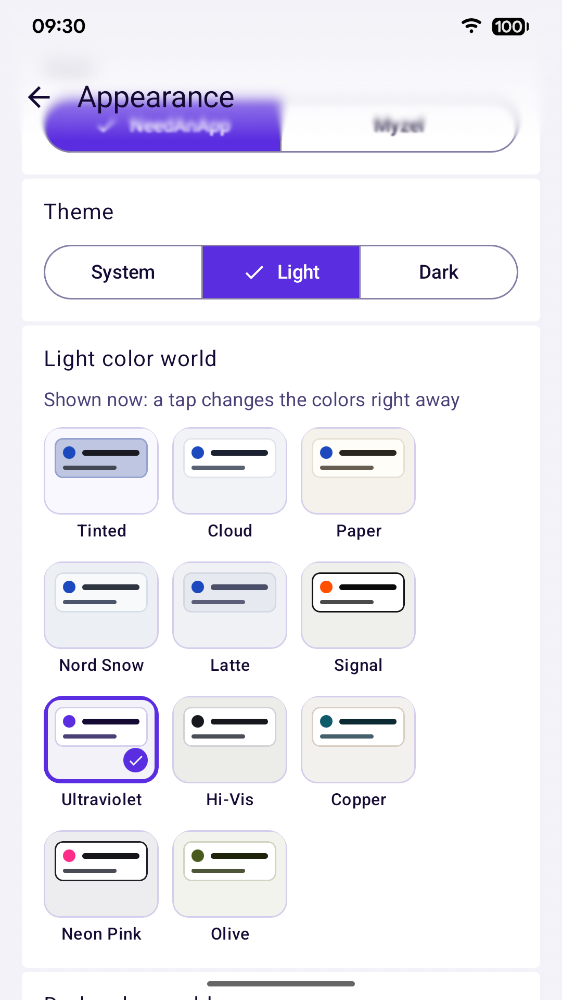<br><sub>Color worlds for light and dark</sub></td>
  </tr>
</table>

## Features

### Phone

- Internal storage, SD cards and USB drives, optionally root
- Tabs for several places, copying and moving in the background with progress and cancel
- List, details, grid or gallery view; zoom with two fingers; group by date, type, size or name
- A long press opens a card with all actions; several marked entries share one card
- Search, home screen shortcuts, text editor
- Checksums (MD5, SHA-1, SHA-256, SHA-512) with comparison against the clipboard

### Network

- SFTP (the server key is checked), SMB, WebDAV and FTPS; unencrypted FTP only after asking, per server
- Self-signed certificates only after confirming their fingerprint, with a warning when they change
- Passwords are kept encrypted in the Android Keystore
- Finds servers in the network (Bonjour/mDNS, WS-Discovery)
- Transfers can be paused; after a connection breaks, the app waits up to an hour and continues where it stopped

### Archives

- Create ZIP (with AES encryption, split) and 7z (also with encrypted file names)
- Extract RAR 4/5, 7z, tar, gz, bz2, xz, ISO, CAB and many more
- Open archives like folders, even on servers

### Vaults

- Create and open Cryptomator vaults, on the phone and on servers; file names and contents stay encrypted
- Unlock with password or fingerprint; recovery key, change password
- Lock themselves in the background or when the screen turns off; a notification counts down and locks them on a tap

### Viewers

- Pictures (JPEG, PNG, WebP, GIF, SVG, HEIC, AVIF, JPEG XL …) with a simple editor
- Documents: PDF, Word, Excel, OpenDocument, Markdown, CSV and HTML

### Also

- Protection by PIN, pattern or fingerprint
- Back up settings and servers in a password-protected file
- Light, dark and pure black, color worlds like Cloud, Nord Night, Signal or Ultraviolet, Material You or an own accent color
- German and English

needafile is free software (GPL-3.0). The app only needs network access for the server connections.

<details>
<summary><b>All features in detail</b></summary>

- Internal storage, SD card, USB and (optionally) root
- Server connections: SFTP (the server key is checked), SMB, WebDAV and FTPS (explicit or implicit; self-signed
  certificates after confirming their fingerprint, warning when they change), unencrypted FTP only after asking, per
  server; credentials encrypted in the Android Keystore
- Find servers in the network: Bonjour/mDNS (SMB, SFTP/SSH, WebDAV, FTP) and Windows computers or NAS via
  WS-Discovery
- Back up and restore settings: appearance, settings and servers (with passwords, confirmed keys and certificates)
  in a password-encrypted file (Argon2id, AES-256-GCM); on import you choose which parts are replaced
- Tabs for several places; copying and moving in the background with progress and cancel, on the device as well as
  between device and server; server transfers can be paused, after a connection breaks the app waits up to an hour
  and continues where it stopped
- Packing and extracting: ZIP (compression level, AES-128/256, split into parts), 7z (compression level, solid
  archive, also with encrypted file names); also extracts RAR 4/5 (also multi-part and encrypted), multi-part 7z,
  tar(.gz/.bz2/.xz), gz, bz2, xz, Z, lzma, ISO, CAB, ARJ, LZH, WIM, CPIO, RPM, DEB, CHM and XAR
- Open archives like folders (read-only, also on servers and nested): view files directly, extract, copy or share
  single files or folders
- Views: list (compact, normal, large), details with columns (a tap on a column sorts), grid and gallery; zoom with
  two fingers; group by date, type, size or first letter with collapsible headers; folders with mostly pictures and
  videos open as a gallery; in general or per folder
- Search, home screen shortcuts, text editor
- Checksums (MD5, SHA-1, SHA-256, SHA-512) in the properties, with comparison against the clipboard
- Picture viewer (JPEG, PNG, WebP, GIF, SVG, HEIC, AVIF, JPEG XL and more) with zoom, swiping through the folder and
  picture details (EXIF); picture editor for cropping, rotating, flipping, scaling and drawing – saves as a copy by
  default
- Document viewer: PDF (also with password), Word (DOCX), Excel (XLSX), OpenDocument (ODS, ODT), Markdown, CSV and
  HTML, with search and printing
- Picture and document viewer also for other apps (“Open with”)
- Cryptomator vaults (format 8 and 7): create and open them, locally and on all servers; thumbnails only in the
  internal cache, swipe through the pictures in a vault; unlock with password or fingerprint, recovery key, change
  password; automatic lock after a chosen time in the background or when the screen turns off (running transfers
  finish first), notification with countdown and lock button
- Protection by PIN, pattern or fingerprint
- Pick a file and “Save as” for other apps
- Appearance: light/dark/pure black, color worlds (Cloud, Paper, Nord Snow, Latte, Graphite, Nord Night, Midnight,
  Dimmed as well as Signal, Ultraviolet, High-Vis, Copper, Neon Pink and Olive with their own accent color),
  Material You or an own accent color, palette styles, progressive blur behind header and navigation, UI scaling,
  own font; app icon in twelve colors
- German and English

</details>

## Thanks

- [7-Zip-JBinding](https://github.com/omicronapps/7-Zip-JBinding-4Android) and p7zip (LGPL-2.1) – 7z, RAR and further archives
- All other libraries with their licenses are listed in the app under Settings → About

## License

GPL-3.0, see [LICENSE](LICENSE).
